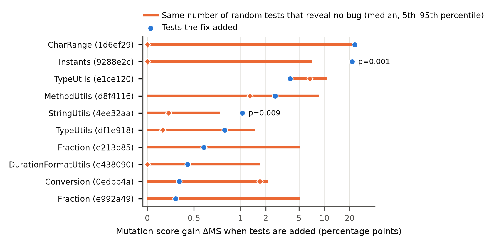

# Every Added Test Raises the Mutation Score

**A pitfall in evaluating mutation testing on bug fixes, and a kill-matrix protocol to avoid it.**
Replication package of a methods note with a 10-bug pilot study on Apache Commons Lang.

🔗 **GitHub Repository:** [https://github.com/Kanhaiya76618/java-mutation-testing-research](https://github.com/Kanhaiya76618/java-mutation-testing-research)

> **Revision notice (October 2026).** Versions of this repository up to commit `e22d960` reported
> results that a re-measurement does not support: several numbers were typed into scripts instead of
> computed, the original CSV had data errors, and the base-vs-augmented comparison it relied on cannot
> show what it claimed. Those documents are kept in [`docs/superseded/`](./docs/superseded/README.md);
> the comparison with the re-measured data is in [`docs/DATA_V1_VS_V2.md`](./docs/DATA_V1_VS_V2.md).

## The pitfall
A common way to ask "do tests that catch a real bug raise the mutation score?" is to take a bug-fix
commit, measure the mutation score of the test suite without the tests the fix added (T_base) and with
them (T_aug), and compare. But T_aug is T_base plus tests, so every mutant T_base kills is still killed:
**the difference can never be negative, whatever the added tests are.** A test across many fixes then
looks "significant" by construction.

## The protocol
1. **Measure, don't assume.** Run the post-fix tests on the buggy version and record which ones fail
   (the fault-revealing tests), using Surefire's per-test results rather than Maven's exit code.
2. **Record PIT's full kill matrix** (`fullMutationMatrix=true`): for every mutant, every test that
   kills it and every test that runs it without killing it. The mutation score of any subset of the
   suite can then be computed without re-running PIT.
3. **Placebo check.** Remove the same number of random tests that do not reveal the bug and measure the
   same mutation-score "gain". If that also looks significant, the naive comparison is uninformative.
4. **Compare equal-size suites.** Draw random test subsets of exactly k tests and ask whether subsets
   that catch the bug have higher mutation scores than subsets that do not (Vargha-Delaney A12), with
   coverage computed from the same matrix as the baseline.
5. **Generate every reported number from the data.** The scripts write the paper's numbers and tables
   into `paper/generated/`; `paper/main.tex` only includes them.

## Pilot results (10 bug fixes, Apache Commons Lang)
- **RQ1, the pitfall:** the naive comparison finds a gain in every pair, and removing random tests that
  reveal no bug produces a "significant" naive result in most placebo replicates. See
  [`docs/PITFALL_ANALYSIS.md`](./docs/PITFALL_ANALYSIS.md).
- **RQ2, equal-size suites:** mutation score ranks bug-detecting subsets only slightly higher, and no
  better than coverage does. See [`docs/SUBSET_ANALYSIS.md`](./docs/SUBSET_ANALYSIS.md).
- **RQ3, operators:** no operator, and not the MATH + CONDITIONALS_BOUNDARY selection the naive analysis
  singled out, gives a clear signal. See the same report.



All numbers are regenerated by `./scripts/reproduce_all.sh` from the committed data; this README links
to the reports instead of repeating their numbers.

## Repository structure
```text
├── harness/                    # Parsers and the kill-matrix model
│   ├── pit_parser.py           # PIT mutations.xml (counts, scores, full kill matrix)
│   ├── surefire_parser.py      # Surefire per-test outcomes
│   ├── kill_matrix.py          # Scores of any test subset; loads one pair's raw data
│   ├── paper_numbers.py        # Writes numbers and tables for the paper (paper/generated/)
│   └── git_miner.py            # Mines bug-fix commits with added tests
├── scripts/
│   ├── run_experiment.py       # Measures one bug pair (needs Java 21, Maven, PIT)
│   ├── batch_runner.py         # Measures a range of mined candidates
│   ├── pitfall_analysis.py     # RQ1: naive comparison vs. placebo
│   ├── subset_analysis.py      # RQ2/RQ3: equal-size test subsets on the kill matrix
│   ├── plot_results.py         # Figures (figures/*.pdf, *.png)
│   ├── paper_tables.py         # LaTeX tables (paper/generated/table_*.tex)
│   ├── compare_v1_v2.py        # Original CSV vs. re-measured data
│   ├── reproduce_all.sh        # Recomputes everything from data/v2 and data/raw
│   └── package_zenodo_artifact.sh
├── data/
│   ├── v2/                     # Re-measured results (runs, operators, skipped, analysis CSVs)
│   ├── raw/<bug_id>/           # Raw PIT reports (with kill matrix), PIT logs, Surefire reports
│   ├── mined_bugs_*.json       # Mined candidates (Commons Lang, Commons CSV, Gson)
│   └── processed_results.csv   # Original v1 data, kept only for comparison
├── docs/                       # Reports, research questions, replication guide, reading list
│   └── superseded/             # First-version documents (do not reuse; see its README)
├── figures/                    # Generated figures
├── paper/                      # main.tex, references.bib, generated/ (numbers and tables)
└── tests/                      # Unit tests (python3 -m unittest discover -s tests)
```

## Reproduce
**Analyses, figures, tables and paper numbers** (Python only, no Java):
```bash
pip install -r requirements.txt
./scripts/reproduce_all.sh
```
**Re-measure the data** (Java 21, Maven, PIT 1.16; slow): see
[`docs/REPLICATION_GUIDE.md`](./docs/REPLICATION_GUIDE.md), step 4.

## Use of AI tools
Parts of the code, reports and paper text were drafted with AI assistants (Claude by Anthropic, and the
Antigravity coding agent) and then reviewed, run and checked against the raw data. Commits with
AI-written code carry a `Co-Authored-By` trailer. The paper discloses AI use in its acknowledgements,
as IEEE policy requires.

## License
MIT, see [`LICENSE`](./LICENSE).
